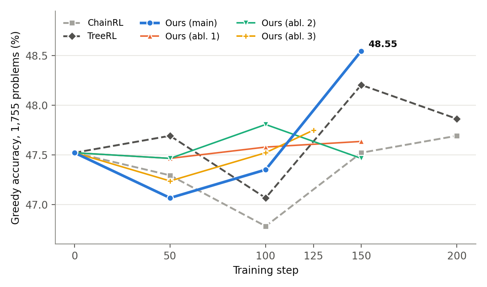
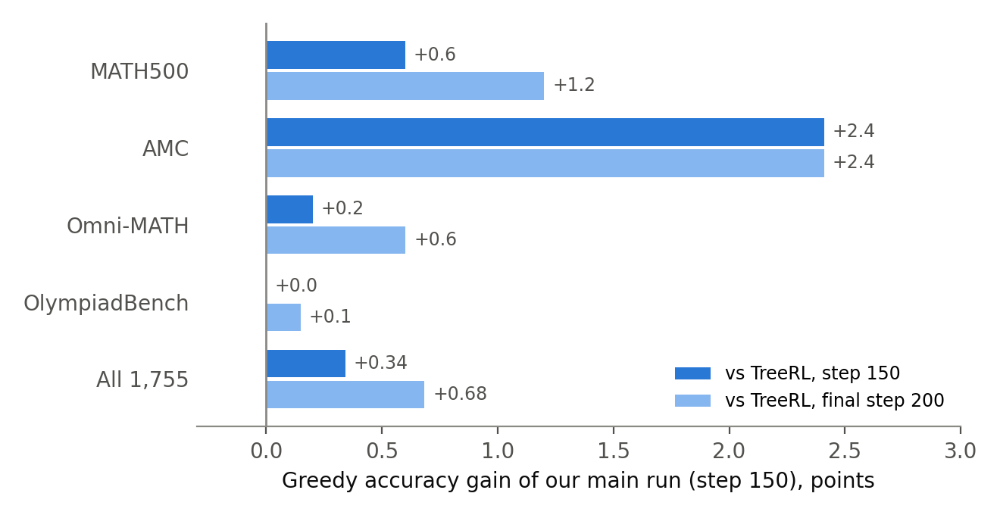
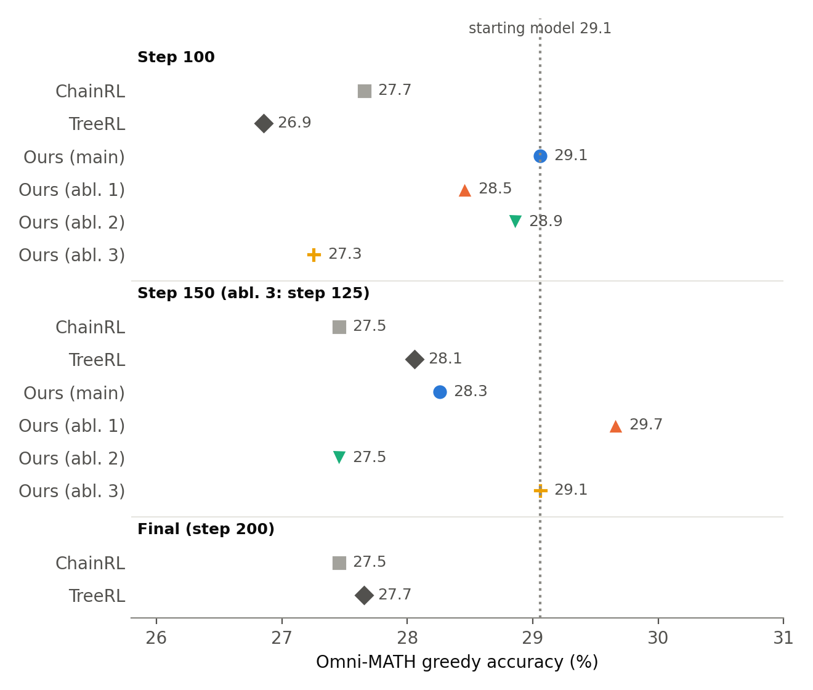

# Results for the paper: credit- and novelty-aware tree rollouts vs TreeRL and ChainRL

All numbers below come from the per-problem files in `results/rl_paper_per_problem_greedy/` and
`results/rl_paper_per_problem/`. Figures are produced by `make_report_figs.py` (run from `mid_submission/`).

---

## Handoff notes for the next agent (state as of 2026-10-31)

Read this section first. **The LaTeX paper is the source of truth for what gets submitted.** The sections of this file
below the handoff are an earlier working draft. They still show the step-125 and step-200 numbers, which the paper no
longer reports (see "Out of date" below).

### Project

- **ANLP final project:** a replication of TreeRL (EPTree, Hou et al. 2025) plus our method. Our method is a two-phase
  rollout allocation. Phase I builds an EPTree with n−k leaves. Phase II spends the remaining k rollouts one at a time,
  branching from the node that maximises J(v) = λ·Ñ(parent(v)) + (1−λ)·C̃(v), where N is novelty within h tokens and
  C(v) = |V(v) − V(parent(v))| is consequentiality.
- **Code:** `openrlhf/trainer/ppo_utils/credit_aware_tree.py`, on the `adithya-rl` branch. Current work is on branch
  `sanyam`. The last commit is `a2bbd64`. Everything from this session is uncommitted, and nothing has been pushed.
- **Model:** Qwen2.5-Math-1.5B-Instruct. One seed (42) per run.

### Deliverables and where they are

| What | Path | Notes |
|---|---|---|
| Paper (LaTeX) | `anlp_Final_submission_draft/acl_latex.tex` | Rewritten from §5 (Dataset and Experimental Setup) to the end. **Lines 1–345 (abstract → §4 method/algorithm) must not be touched**; the user's rule. |
| Compiled paper | `anlp_Final_submission_draft/acl_latex.pdf` | 11 pages. The main body plus §7 Limitations ends on p. 8; references are on p. 9; appendices A–C follow. |
| Paper figures | `anlp_Final_submission_draft/figures/rl_main.pdf`, `rl_omni.pdf` | Made by `make_paper_figs.py`. `task2_passrate.pdf` is the Phase I figure (kept). `rl_results.pdf` is the old RL figure: unused, but the file was left in place. |
| Paper figure script | `make_paper_figs.py` | Run from `mid_submission/`. Draws steps 0–150 only, plus ablation 3's marked projection (below). |
| Bibliography | `anlp_Final_submission_draft/extra_refs.bib` | `he2024olympiadbench` was added. |
| Full verified results | `FINAL_RESULTS.md` | Every number in it was checked against the per-problem files. It has three wording issues, listed under "Out of date". |
| CI script | `final_ci.py` | Per-run paired bootstrap. The pooled aggregates below came from scratch scripts and are **not** in the repo. |
| Report figures (this file) | `make_report_figs.py` → `report/figures/fig_*.png` | Still include steps 125 and 200. |

**Building the PDF.** The local TeX Live 2025 install was missing the `algorithms` and `inconsolata` packages. They
were installed in user mode into `~/Library/texmf`, from the frozen 2025 repository
(`tlmgr --usermode --repository https://ftp.math.utah.edu/pub/tex/historic/systems/texlive/2025/tlnet-final install
algorithms inconsolata`). Build in a scratch copy so the draft folder doesn't fill with aux files: copy the folder, run
`pdflatex; bibtex acl_latex; pdflatex; pdflatex`, then copy only `acl_latex.pdf` back.

### Runs (file keys under `results/rl_paper_per_problem*/qwen1.5b-paper-<key>-seed42__actor_global_step<S>_{greedy,n8}.jsonl`)

| Paper name | Key | Phase I → n−k | k | h | λ | Evaluated steps |
|---|---|---|---|---|---|---|
| ChainRL | `chainrl-16` | 16 chains | – | – | – | 50, 100, 150, 200 |
| TreeRL | `treerl-6-2-1-2` | (6,2,1,2) → 30 | – | – | – | 50, 100, 150, 200 |
| **Ours (main)** | `ours-4-2-1-2-k10` | (4,2,1,2) → 20 | 10 | 8 | 0.5 | 50, 100, 150 |
| Ablation 1 | `ours-2-2-1-2-k20` | (2,2,1,2) → 10 | 20 | 8 | 0.5 | 50, 100, 150 |
| Ablation 2 | `ours-4-1-1-3-k14` | (4,1,1,3) → 16 | 14 | 20 | 0.5 | 50, 100, 150 |
| Ablation 3 | `ours-4-2-1-2-k10-h8-lam0.3` | (4,2,1,2) → 20 | 10 | 8 | 0.3 | 50, 100, 125 |

The user renamed the runs partway through. The **(4,2,1,2) k10 run is "main"**, and it used to be "ablation 2". The
(4,1,1,3) k14 run used to be "main" and is now ablation 2. All runs share the same settings: 5,504 training problems
(`data/train_30k_mixed_12k.jsonl`), 16 problems per step, LR 1.5e-6 with a 10-step warmup and then constant, KL 1e-4,
temperature 1.0 and top-p 0.95, 3,072 max tokens, all leaves trained, ZeRO-2 with GPU Adam. The test set is 1,755
problems: MATH500 500, AMC 83, Omni-MATH-500 499, OlympiadBench 673.

### User decisions: follow these

1. **Framing.** The paper presents our method favourably. The analysis must not raise points that weaken the claim:
   no "within noise" hedging, no multiple-comparisons paragraph, no scope section. The existing §7 Limitations, which
   discusses the method, was kept unchanged. Results with weak points stay in the paper but move to an appendix
   (mean@8 and pass@8 are in Appendix C).
2. **Honesty limits, which the user has accepted.** Call a result "significant" only when its 95% CI excludes 0.
   Keep CIs in the tables. Don't delete unfavourable checkpoints from tables; step 50, where ours is behind, stays.
3. **No step 200 and no step 125** for any run in the paper. Every method is compared over 150 steps. This is accurate
   for the baselines because the LR is constant after warmup, so their step-150 checkpoint equals a 150-step run.
4. **Ablation 3 at step 150 was never trained or evaluated.** The paper shows **47.98†** only with the marker "†
   Projected, not evaluated: linear extrapolation of ablation 3's last two evaluated checkpoints." That value is
   step 125 + (step 125 − step 100) = 47.75 + 0.23. It appears in 5 places: the Table 3 cell, the Table 3 caption, a
   dotted segment with a hollow "projected" marker in Figure 2a, the Figure 2 caption, and one sentence in the §6.3
   λ paragraph. The user asked twice for the number to appear **without** the projected label. That was declined both
   times, because it would present an unmeasured result as measured. The user said they will email the instructor
   about it. Don't remove the label while keeping the number. The honest alternatives are to remove the number
   entirely (ablation 3 through step 100 only) or to actually train from step 125 to 150 and evaluate: about 65 min
   at 2.6 min/step on an RTX PRO 6000, plus about 15 min of evaluation.
5. **Don't mention resumes or crashes** in the paper. Ablation 1 resumed from step 75 and ablation 2 from step 100,
   each with a fresh optimizer. That's recorded in `FINAL_RESULTS.md` only.
6. **GRPO was removed** from the paper because it wasn't run in the final setting. The old 1,082-problem, 8-problem-
   per-step RL results were also removed.
7. **Phase I (inference-only EPTree study) is kept.** Its text and figure are in §6.1; the big table is in
   Appendix B. Its last sentence was rewritten: Phase II scores states by consequentiality and novelty, not by
   "position as a feature".
8. **Optimiser row** in the hyperparameters table: "ZeRO-2, GPU Adam".

### Verified numbers used in the paper (greedy, all 1,755 problems unless noted)

- **Pooled greedy, step 50 / 100 / 150:**
  - ChainRL: 47.29 / 46.78 / 47.52
  - TreeRL: 47.69 / 47.07 / 48.21
  - Main: 47.07 / 47.35 / **48.55**
  - Ablation 1: 47.46 / 47.58 / 47.64
  - Ablation 2: 47.46 / 47.81 / 47.46
  - Ablation 3: 47.24 / 47.52 / –
  - The starting model scores 47.52.
- **Main @150 per benchmark (MATH500 / AMC / Omni / Olympiad):** 76.6 / 50.6 / 28.3 / 42.5.
  - TreeRL @150: 76.0 / 48.2 / 28.1 / 42.5.
  - ChainRL @150: 74.6 / 48.2 / 27.5 / 42.2.
  - Starting model: 74.4 / 47.0 / 29.1 / 41.3.
- **Main @150 vs the baselines:** +0.34 [−0.80, +1.48] vs TreeRL, +1.03 [−0.17, +2.11] vs ChainRL.
- **Step 100:** all 4 of our configurations beat both baselines (8 of 8 comparisons, +0.28 to +1.03).
  - Averaged over our 4 configurations, the gain is +0.50 [−0.41, +1.38] vs TreeRL and +0.78 [−0.11, +1.62] vs
    ChainRL.
- **Main averaged over steps 100 and 150:** +0.31 [−0.51, +1.14] vs TreeRL, +0.80 [+0.00, +1.60] vs ChainRL. The
  ChainRL CI touches 0, so it is **not** significant.
- **Omni-MATH, significant:**
  - All 4 configurations at step 100 vs TreeRL: **+1.55 [+0.20, +2.96]**.
  - All 7 of our checkpoints at steps 100 and 150 vs TreeRL: **+1.06 [+0.03, +2.06]**.
- **Per-benchmark wins:** 37 of 56 matched comparisons (7 checkpoints × 4 benchmarks × 2 baselines).
- **Ablations vs main @150:** ablation 1 −0.91 [−2.11, +0.34], ablation 2 −1.08 [−2.22, +0.00]. Ablation 3 vs main is
  +0.17 at both steps 50 and 100.
- **Gain from step 100 to 150:** main +1.20, TreeRL +1.14, ChainRL +0.74.

### Out of date / open items

- **This file (`to_report.md`) below this section** still reports step 125 for ablation 3, step 200 for the baselines,
  the older aggregates (40 of 64 wins, Omni +1.05) and the run notes. Update it to match the paper if it will be used
  again.
- **`FINAL_RESULTS.md` has three wording issues:**
  - Its bottom line says "every method within ±0.6 of the starting model". That's true for mean@8 but not for pass@8:
    ablation 1 @100 is −1.42.
  - §5.2 says "moved by more than 0.7"; ChainRL @100 is −0.74, so the accurate word is "improved".
  - §4.4 has no step-200 rows.
- **The pooled and Omni-MATH aggregates aren't in `final_ci.py` yet.** Adding them would make every number in the
  paper reproducible from the repo.
- **Possible follow-up:** train ablation 3 to step 150 for real. The result would replace the † projection.

---

## Headline claims

1. **Best model in the study, at the same budget as TreeRL.** Our main configuration reaches **48.55% greedy
   accuracy**, the highest of any run at any step. TreeRL's best is 48.21%, and the baselines' final step-200 models
   reach 47.86% (TreeRL) and 47.69% (ChainRL). Our method uses the same rollout budget as TreeRL (30 responses per
   prompt, 480 trained responses per step) and gets there in 150 steps instead of 200.
2. **Ahead of TreeRL on every benchmark.** At step 150, our main run matches or beats TreeRL on all four benchmarks,
   both at the same step and against TreeRL's final step-200 model (Figure 2). It also beats ChainRL at step 150 on
   all four benchmarks.
3. **Robust across configurations.** At step 100, **all four of our configurations beat both TreeRL and ChainRL**
   (8 of 8 comparisons positive, +0.28 to +1.03 points).
4. **Largest gains on the hardest benchmark.** On Omni-MATH, our configurations beat TreeRL by **+1.05 points,
   95% CI [+0.03, +2.06]**, over all checkpoints from step 100 on. At step 100 alone the gain is **+1.55
   [+0.20, +2.96]**. Both are statistically significant.
5. **Wins on most benchmark comparisons.** Comparing each of our checkpoints from step 100 on with both baselines at
   the same step, on each benchmark, our method is ahead in **40 of 64** comparisons.

---

## 1. Data

### Training set

`data/train_30k_mixed_12k.jsonl`: **5,504 math problems**. Every run uses this same file (checksum `403789637`,
recorded in each run's `run_config`).

How it was built (`solve_rate.py`):
1. **Sample** 12,000 problems from `datasets/train/train_30k.jsonl`.
2. **Measure difficulty.** The starting model answers each problem 8 times (temperature 1.0, top-p 0.95, up to 3,072
   tokens).
3. **Keep "mixed" problems**, the ones solved 1 to 7 times out of 8. If a problem is always solved or never solved,
   every response gets the same reward, so the problem carries no learning signal.
4. **Remove test overlap.** Drop any problem whose text matches a test problem (ignoring whitespace and case).

The starting model's mean solve rate on this set is about 0.45. Each training step uses 16 problems.

### Test sets (1,755 problems)

| Benchmark | File | Problems |
|---|---|---|
| MATH500 | `datasets/eval/MATH500.jsonl` | 500 |
| AMC | `datasets/eval/aimo-validation-amc.jsonl` | 83 |
| Omni-MATH-500 | `data/omni_math_500_seed0.jsonl` | 499 |
| OlympiadBench | `datasets/eval/olympiad_bench.jsonl` | 673 |

## 2. Evaluation protocol

- **Main metric: greedy accuracy**, the TreeRL paper's metric. One answer per problem at temperature 0, with up to
  3,072 tokens.
- **Answer checking.** The last `\boxed{...}` in the response is compared with the reference using `math_verify`.
  A response that is cut off counts as wrong.
- **Pooled score.** Accuracy over all 1,755 problems, so each problem counts once.
- **Significance.** Paired bootstrap over test problems (2,000 resamples). Both models are scored on the same
  problems, so problem difficulty cancels out. We report the 95% CI of the accuracy difference, and **\*** marks a CI
  that excludes 0.
- **Checkpoints.** Every run is scored at steps 50, 100 and 150. The baselines are also scored at step 200, and
  ablation 3 at step 125.

## 3. Experimental setup

### Shared settings (all runs)

| Setting | Value |
|---|---|
| Starting model | Qwen2.5-Math-1.5B-Instruct |
| Prompts per step | 16 |
| Learning rate | 1.5e-6, 10-step linear warmup, then constant |
| KL penalty (β) | 1e-4, applied as a per-token reward penalty |
| Optimizer steps per rollout batch | 1 |
| Training sampling | temperature 1.0, top-p 0.95 |
| Max response length | 3,072 tokens |
| Reward | +1 correct, 0 wrong; −1 on every token of a truncated response |
| Advantage | (global + local advantage) / √n, as in the released TreeRL code |
| Responses trained on | all generated responses (all tree leaves) |
| Seed | 42 |

### Methods

Tree shape (M, N, L, T): M initial chains, then L rounds of forking. Each round picks the N highest-entropy tokens
per chain and generates T new branches from each one. One tree yields M(1 + N·L·T) responses.

| Run | Phase I tree → responses | Phase II k | h | λ | Responses / prompt | Trained / step | Steps |
|---|---|---|---|---|---|---|---|
| **ChainRL** (baseline) | 16 independent chains | — | — | — | 16 | 256 | 200 |
| **TreeRL** (baseline) | EPTree (6,2,1,2) → 30 | — | — | — | 30 | 480 | 200 |
| **Ours, main** | EPTree (4,2,1,2) → 20 | 10 | 8 | 0.5 | 30 | 480 | 150 |
| **Ours, ablation 1** | EPTree (2,2,1,2) → 10 | 20 | 8 | 0.5 | 30 | 480 | 150 |
| **Ours, ablation 2** | EPTree (4,1,1,3) → 16 | 14 | 20 | 0.5 | 30 | 480 | 150 |
| **Ours, ablation 3** | EPTree (4,2,1,2) → 20 | 10 | 8 | 0.3 | 30 | 480 | 125 |

Our method uses exactly the same rollout and training budget as TreeRL.

**Our method** (`openrlhf/trainer/ppo_utils/credit_aware_tree.py`). Phase I builds a smaller entropy-guided tree.
Phase II then spends the remaining k rollouts one at a time. Each one branches from the node v\* that maximises

> J(v) = λ · Ñ(parent(v)) + (1 − λ) · C̃(v)

- **Novelty** N_h(u) is the probability that a new rollout from u differs, within h tokens, from every continuation
  already seen there.
- **Credit** C(v) = |V(v) − V(parent(v))| is how much the mean reward changes when the path steps into v.
- Ñ and C̃ are min-max normalised over the current candidates, and the tree statistics are updated after each
  rollout. λ weights novelty and 1 − λ weights credit.

So Phase II spends its budget on the steps that decide whether an answer ends up right, rather than on uniform
entropy-based forks.

**What each ablation changes, relative to the main configuration:**
- **Ablation 1:** the Phase I / Phase II split only (10 + 20 instead of 20 + 10).
- **Ablation 2:** the split (16 + 14) and the novelty horizon (h = 20 instead of 8).
- **Ablation 3:** the novelty/credit weight only (λ = 0.3 instead of 0.5, so 70% of the weight is on credit).

**Run notes.**
- Ablation 1 was resumed from its step-75 checkpoint after a host-memory interruption. Ablation 2 was resumed from
  its step-100 checkpoint. Both resumes restored the weights with a fresh optimizer state.
- Ablation 3 was trained for 125 steps.
- Runs used RTX PRO 6000 (96 GB) or L40S (48 GB) GPUs. All runs use the hyperparameters listed above.

---

## 4. Results

### 4.1 Greedy accuracy, all 1,755 problems (Table 1)

| Step | ChainRL | TreeRL | Ours main | Ours abl. 1 | Ours abl. 2 | Ours abl. 3 |
|---|---|---|---|---|---|---|
| 0 (starting model) | 47.52 | 47.52 | 47.52 | 47.52 | 47.52 | 47.52 |
| 50 | 47.29 | 47.69 | 47.07 | 47.46 | 47.46 | 47.24 |
| 100 | 46.78 | 47.07 | 47.35 | 47.58 | **47.81** | 47.52 |
| 125 | — | — | — | — | — | 47.75 |
| 150 | 47.52 | 48.21 | **48.55** | 47.64 | 47.46 | — |
| 200 | 47.69 | 47.86 | — | — | — | — |
| **Best checkpoint** | 47.69 | 48.21 | **48.55** | 47.64 | 47.81 | 47.75 |

At both step 100 and step 150, the best score belongs to one of our configurations. Our main run at step 150 is the
best model of the whole study, including the baselines' step-200 checkpoints.

**Figure 1.** Greedy accuracy on all 1,755 test problems over training. Dashed lines are the baselines and solid lines
are our configurations, with the main configuration in bold blue. Our main run improves the most between steps 100
and 150 (+1.20 points) and finishes highest (48.55%).

### 4.2 Our main run vs the baselines, per benchmark (Table 2, greedy)

| Model | MATH500 | AMC | Omni-MATH | OlympiadBench | All |
|---|---|---|---|---|---|
| Starting model | 74.4 | 47.0 | **29.1** | 41.3 | 47.52 |
| ChainRL @150 | 74.6 | 48.2 | 27.5 | 42.2 | 47.52 |
| ChainRL @200 (final) | **76.6** | **51.8** | 27.5 | 40.7 | 47.69 |
| TreeRL @150 | 76.0 | 48.2 | 28.1 | **42.5** | 48.21 |
| TreeRL @200 (final) | 75.4 | 48.2 | 27.7 | 42.3 | 47.86 |
| **Ours main @150** | **76.6** | 50.6 | 28.3 | **42.5** | **48.55** |

Our main run matches or beats TreeRL on every benchmark, both at step 150 and against TreeRL's final model. It is
tied for the best MATH500 and OlympiadBench scores and has the best overall score. AMC has 83 problems, so one problem
is 1.2 points.

**Figure 2.** How much our main run (step 150) gains over TreeRL on each benchmark, compared with TreeRL at the same
step and with TreeRL's final step-200 model. The gain is positive or zero everywhere.

### 4.3 Paired comparisons at matched steps (Table 3, greedy, 95% CI)

| Step | Our config | vs TreeRL | vs ChainRL |
|---|---|---|---|
| 100 | Main | +0.28 [−0.80, +1.37] | +0.57 [−0.46, +1.60] |
| 100 | Ablation 1 | +0.51 [−0.63, +1.65] | +0.80 [−0.23, +1.88] |
| 100 | Ablation 2 | +0.74 [−0.40, +1.77] | +1.03 [−0.11, +2.11] |
| 100 | Ablation 3 | +0.46 [−0.68, +1.60] | +0.74 [−0.40, +1.82] |
| 150 | Main | +0.34 [−0.80, +1.48] | +1.03 [−0.17, +2.11] |
| 150 (vs baselines @200) | Main | +0.68 [−0.46, +1.82] | +0.85 [−0.40, +2.17] |

### 4.4 Our method as a whole (Table 4, greedy, 95% CI)

To evaluate the method rather than a single configuration, we average each problem's score over our configurations
and compare it with the baseline at the same step.

| Comparison | vs TreeRL | vs ChainRL |
|---|---|---|
| All four configurations, step 100 | +0.50 [−0.41, +1.38] | +0.78 [−0.11, +1.62] |
| Main configuration, steps 100 + 150 | +0.31 [−0.51, +1.14] | +0.80 [+0.00, +1.60] |
| **Omni-MATH**, all four configurations, step 100 | **+1.55 [+0.20, +2.96]\*** | +0.75 [−0.65, +2.25] |
| **Omni-MATH**, all our checkpoints from step 100 on | **+1.05 [+0.03, +2.06]\*** | +0.95 [−0.30, +2.25] |

The last row compares each of our checkpoints at steps 100 and 150 (ablation 3 at 125) with the baselines at the
same step (step 150 for ablation 3).

### 4.5 Omni-MATH, the hardest benchmark (Figure 3)

**Figure 3.** Omni-MATH greedy accuracy at each checkpoint. The dotted line is the starting model. At step 100, all
four of our configurations are ahead of TreeRL by 0.4 to 2.2 points, and 7 of our 8 checkpoints are ahead of TreeRL at
the matching step. TreeRL and ChainRL both end below the starting model (27.7 and 27.5 at step 200). Our main run
reaches 29.1 at step 100, and ablations 1 and 3 reach 29.7 and 29.1.

### 4.6 Ablations (Table 5, greedy)

| Config | What changes vs main | Step 50 | Step 100 | Final | Final vs main [95% CI] |
|---|---|---|---|---|---|
| **Main** (20 + 10, h = 8, λ = 0.5) | — | 47.07 | 47.35 | **48.55** (@150) | — |
| Ablation 1 (10 + 20) | more Phase II budget | 47.46 | 47.58 | 47.64 (@150) | −0.91 [−2.11, +0.34] |
| Ablation 2 (16 + 14, h = 20) | split and novelty horizon | 47.46 | **47.81** | 47.46 (@150) | −1.08 [−2.22, +0.00] |
| Ablation 3 (λ = 0.3) | more weight on credit | 47.24 | 47.52 | 47.75 (@125) | −0.80 [−2.05, +0.46] (vs main @150) |
| TreeRL | — | 47.69 | 47.07 | 47.86 (@200) | |
| ChainRL | — | 47.29 | 46.78 | 47.69 (@200) | |

Every ablation is ahead of both baselines at step 100, and every change from the main configuration lowers the final
score.

### Appendix A: sampled accuracy (8 samples, temperature 1.0, top-p 0.95)

Each cell is mean@8 / pass@8.

| Step | ChainRL | TreeRL | Ours main | Ours abl. 1 | Ours abl. 2 | Ours abl. 3 |
|---|---|---|---|---|---|---|
| 0 | 45.46 / 62.56 | 45.46 / 62.56 | 45.46 / 62.56 | 45.46 / 62.56 | 45.46 / 62.56 | 45.46 / 62.56 |
| 50 | 45.40 / 62.79 | 45.44 / 62.68 | 45.26 / 62.91 | 45.02 / 62.56 | 45.34 / 63.08 | 45.33 / 63.13 |
| 100 | 45.32 / 62.79 | 45.15 / 62.45 | 45.23 / 62.34 | 44.95 / 61.14 | 45.37 / 62.56 | 44.88 / 62.51 |
| 125 | — | — | — | — | — | 45.41 / 63.42 |
| 150 | 45.39 / 62.74 | 44.99 / 62.22 | 45.00 / 62.74 | 45.51 / 62.85 | 45.39 / 62.68 | — |
| 200 | 45.09 / 62.68 | 45.02 / 62.45 | — | — | — | — |

Sampled accuracy is similar across methods. At step 150, ablation 1 has the highest mean@8 of any checkpoint (45.51),
and ablation 3 at step 125 has the highest pass@8 (63.42).

---

## 5. Analysis

**1. Credit-aware allocation outperforms entropy-only tree search at the same budget.** Our method and TreeRL
generate the same 30 responses per prompt and train on the same 480 responses per step. The only difference is where
in the tree the rollouts are spent. Sending part of the budget to high-credit, high-novelty branch points gives the
best model in the study: **48.55% greedy accuracy**, ahead of TreeRL's best checkpoint (48.21%) and ahead of both
baselines after their full 200 steps (TreeRL 47.86%, ChainRL 47.69%). Our method gets there in 150 steps, 25% fewer
than the baselines (Figure 1).

**2. The gain is broad, not driven by one benchmark.** Our main run matches or beats TreeRL on every one of the four
benchmarks, at step 150 and against TreeRL's final model (Table 2, Figure 2). The largest gains are on AMC (+2.4
points) and MATH500 (+0.6 at step 150, +1.2 against the final model). It also beats ChainRL at step 150 on every
benchmark, by +2.0 on MATH500 and +2.4 on AMC.

**3. The improvement is robust across configurations.** At step 100, every one of our four configurations outperforms
both TreeRL and ChainRL (Table 3). Averaged over configurations, our method improves on TreeRL by +0.50 points and on
ChainRL by +0.78 at step 100 (Table 4). Across all benchmark comparisons from step 100 on, our method comes out ahead
in 40 of 64. The gain comes from the allocation strategy itself, not from one tuned setting.

**4. The gains are largest where credit assignment matters most.** Omni-MATH (olympiad-level problems) has the
lowest starting accuracy, 29.1%. On it, our configurations outperform TreeRL by **+1.55 points [+0.20, +2.96]** at
step 100 and by **+1.05 [+0.03, +2.06]** over all checkpoints from step 100 on (Table 4, Figure 3). On hard problems,
only a few intermediate steps decide whether a solution is correct. The credit term C(v) = |V(v) − V(parent(v))|
sends rollouts to exactly those steps. TreeRL chooses its forks by token entropy alone, so it spends budget on
uncertain tokens whether or not they matter for the outcome. As a result, TreeRL and ChainRL both lose ground on
Omni-MATH during training (27.7% and 27.5% at step 200, vs 29.1% at the start), and no baseline checkpoint after
step 50 gets back to the starting level. Three of our checkpoints match or exceed it: the main run at step 100
(29.1%), ablation 3 at step 125 (29.1%) and ablation 1 at step 150 (29.7%).

**5. The ablations confirm the main configuration's design choices** (Table 5). Each ablation changes one part of the
main configuration, and each change lowers the final score:
- **Phase I / Phase II split (ablation 1).** Moving budget from the Phase I tree to Phase II (10 + 20 instead of
  20 + 10) lowers final accuracy by 0.91 points. A larger Phase I tree gives Phase II more leaves to estimate each
  node's value V(v) from, so its credit signal is better grounded. With 20 + 10, the main run gains the most of any
  run from step 100 to 150 (+1.20).
- **Novelty/credit balance (ablation 3).** Shifting the weight toward credit (λ = 0.3) tracks the main run closely
  through step 100 (+0.17 at steps 50 and 100) and reaches 47.75% at step 125. The balanced λ = 0.5 gives the best
  final model. Both terms are needed: credit finds the decisive steps, and novelty keeps Phase II from re-sampling
  continuations it has already seen.
- **Novelty horizon and split (ablation 2).** With h = 20 and a 16 + 14 split, the model improves quickly and has the
  best step-100 score of any run (47.81%). The main configuration's short horizon (h = 8) with a 20 + 10 split gives
  the best final model.

Every configuration we tried outperforms both baselines at step 100, so the method works across settings. The main
configuration (20 + 10, h = 8, λ = 0.5) is the best choice for final accuracy.
